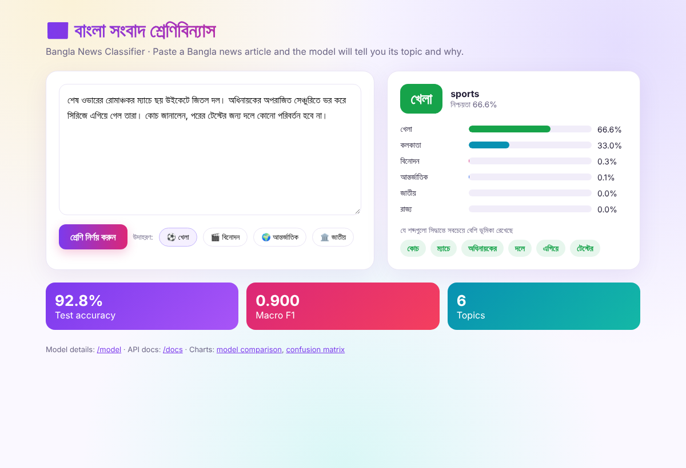
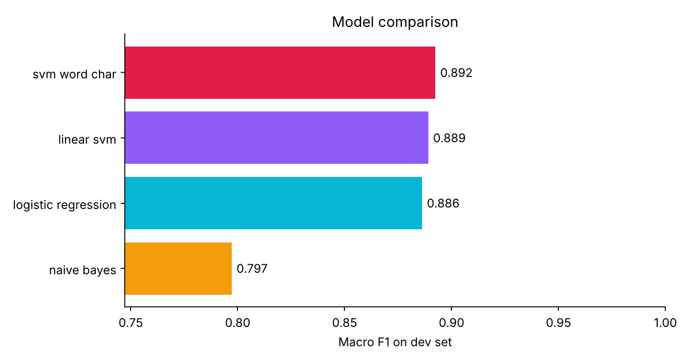
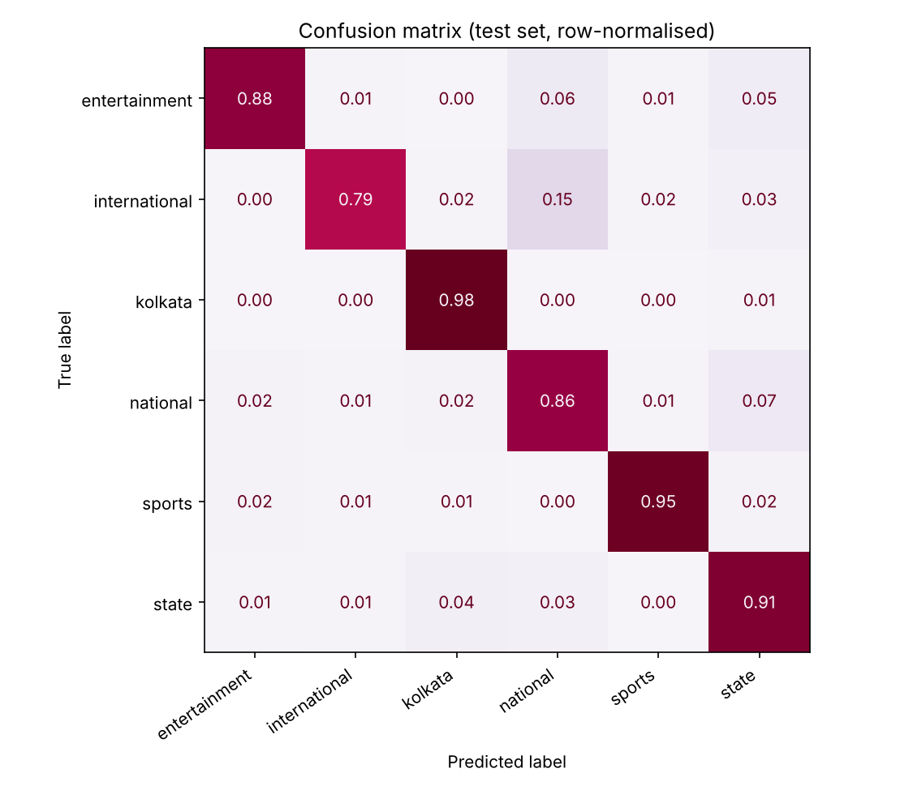

# 📰 Bangla News Classifier

A machine learning system that reads a **Bangla news article** and predicts its topic (sports, entertainment, international, national, state, Kolkata). It also **explains** the prediction by showing the words that pushed the model toward that topic. The trained model is served through a **FastAPI** REST API with a colourful web demo.




## Results

Trained on **11,122** articles, tuned on 1,409 (dev) and evaluated once on **1,409 held-out test articles**.

| Metric (test set) | Score |
|---|---|
| Accuracy | **92.8%** |
| Macro F1 | **0.900** |

**Model comparison (dev set):**

| Model | Features | Accuracy | Macro F1 |
|---|---|---|---|
| Complement Naive Bayes | word TF-IDF (1–2 grams) | 84.5% | 0.797 |
| Logistic Regression | word TF-IDF (1–2 grams) | 91.9% | 0.886 |
| Linear SVM | word TF-IDF (1–2 grams) | 92.3% | 0.889 |
| **Linear SVM + calibration** | **word + character TF-IDF** | **92.5%** | **0.892** |

<p>
  
  
</p>

**Per-class results on the test set:**

| Topic | Precision | Recall | F1 | Articles |
|---|---|---|---|---|
| Kolkata | 0.970 | 0.975 | 0.973 | 569 |
| Sports | 0.968 | 0.953 | 0.960 | 191 |
| State | 0.888 | 0.914 | 0.901 | 278 |
| Entertainment | 0.905 | 0.877 | 0.891 | 130 |
| National | 0.847 | 0.857 | 0.852 | 175 |
| International | 0.867 | 0.788 | 0.825 | 66 |

**What the confusion matrix shows:** most mistakes are *international* articles predicted as *national* (15%). Both talk about governments, ministers and elections, and international is the smallest class (66 test articles), so it is the hardest to learn. Macro F1 is reported next to accuracy because the classes are imbalanced (Kolkata alone is 41% of the data).

## How it works

```
 Bangla text
     │
     ▼
 Cleaning ─── Unicode NFC, keep Bangla letters only, numbers → one token, remove stopwords
     │
     ├──▶ Word TF-IDF (1–2 grams)          ← topic words: "ক্রিকেট", "মার্কিন প্রেসিডেন্ট"
     └──▶ Character TF-IDF (2–4 grams)     ← handles Bangla word endings: "দলের", "দলকে", "দলে"
                │
                ▼
     Linear SVM (class-balanced) + probability calibration
                │
                ▼
     Topic + confidence + top contributing words
```

- **Why character n-grams?** Bangla adds many endings to words (বিভক্তি). Character pieces let the model see that "অধিনায়কের" and "অধিনায়ক" are related without a stemmer.
- **Why calibration?** An SVM gives scores, not probabilities. `CalibratedClassifierCV` converts them so the API can return a real confidence for each topic.
- **Explainability:** for the predicted topic, each word's TF-IDF value is multiplied by the model's weight for that word, and the highest ones are returned as `keywords`.
- **Honest evaluation:** models are compared only on the dev split. The test split is used once, at the end.

## API

| Method | Endpoint | Description |
|---|---|---|
| POST | `/predict` | Classify one article |
| POST | `/predict/batch` | Classify up to 50 articles |
| GET | `/model` | Model name, classes and scores |
| GET | `/health` | Health check |
| GET | `/` | Web demo |
| GET | `/docs` | Interactive API docs |

```bash
curl -X POST localhost:8000/predict -H "Content-Type: application/json" \
  -d '{"text": "ক্রিকেট ম্যাচে সেঞ্চুরি করলেন অধিনায়ক, সিরিজ জিতল দল"}'
```

```json
{
  "label": "sports",
  "label_bn": "খেলা",
  "confidence": 0.76,
  "probabilities": { "sports": 0.76, "kolkata": 0.21, "...": 0.0 },
  "keywords": ["ক্রিকেট", "ম্যাচ", "অধিনায়ক", "সেঞ্চুরি"]
}
```

## Run it

### Docker

```bash
docker build -t bangla-news-classifier .   # downloads the data and trains the model
docker run -p 8000:8000 bangla-news-classifier
```

Open http://localhost:8000.

### Local

```bash
python -m venv .venv && source .venv/bin/activate   # Windows: .venv\Scripts\activate
pip install -r requirements-dev.txt

PYTHONPATH=src python -m bnc.train                  # about 2 minutes on a laptop
PYTHONPATH=src:. uvicorn app.main:app --reload
```

On Windows PowerShell, set the path with `$env:PYTHONPATH="src;."` first.

### Tests

```bash
pytest -v
```

## Project structure

```
src/bnc/
├── data.py         Download and robust loading of the dataset
├── preprocess.py   Bangla text cleaning and stopwords
├── models.py       The four candidate pipelines
├── train.py        Train, compare, evaluate, save model and charts
└── predict.py      Load model, predict, explain
app/
├── main.py         FastAPI service
└── static/         Web demo
reports/            Metrics and charts from the last training run
tests/              pytest suite
```

## Dataset

[Bangla news categorization dataset](https://github.com/banglanlp/bnlp-resources/tree/main/news_categorization) from the IndicNLP corpus (AI4Bharat), with the standard train / dev / test split used in *Bangla Text Classification using Transformers* (Alam et al., 2020). Licensed CC BY-NC-SA 4.0. The data is downloaded at training time and is not stored in this repository.

## Next steps

- Fine-tune a transformer (BanglaBERT) and compare it with this baseline
- Train on Bangladeshi news sources for local categories
- Add the model to a news reader app for automatic tagging

## Author

**Abir Ahamed Omi**: CSE, Premier University, Chittagong
[GitHub](https://github.com/Abir-omi) · omiabir3@gmail.com
